# Core rasterizer vs. OS rendering (E4.2)

The core rasterizer (`fm_core::preview`) draws thumbnails, CLI previews and the
MCP `render_preview` image. The UI font list does not use it: the list renders
with the webview's own engine. This page records how close the core output is to
the operating system's text rendering, so a thumbnail looks like the font the
user sees elsewhere.

## How it renders

- Shaping: `rustybuzz` (HarfBuzz rules: kerning, ligatures, marks, Arabic and
  Syriac joining, Indic reordering), one run per text direction. Mixed
  left-to-right and right-to-left text is ordered with the single-line rules of
  the Unicode bidirectional algorithm.
- Rasterizing: `swash`, unhinted outlines, grayscale antialiasing, subpixel
  pen positions. TrueType (`glyf`), CFF and CFF2 outlines; variation
  coordinates from the request; COLR v0 colour layers with the font's first
  palette; embedded colour bitmaps (`CBDT`, `sbix`).
- Not drawn in colour: COLR v1 and `SVG ` glyphs. They fall back to the plain
  outlines in the foreground colour (swash 0.2 paints COLR v0 only).

## Method

`docs/previews/compare-os.ps1` (Windows; run from the repository root with
`pwsh -STA -File docs/previews/compare-os.ps1`) renders each sample twice at the
same pixel size, black on white:

1. the core: `cargo run -p fm-core --example render_preview`;
2. Windows: WPF text (OpenType shaping, grayscale antialiasing, 96 DPI, so one
   pixel equals one device-independent pixel).

Both images are cropped to their ink box (pixels at least 50 % dark). The table
compares the ink box sizes and the mean absolute difference of darkness (0 =
identical, 1 = inverted) over the union of the two boxes, aligned at the
top-left.

## Results (2026-10-18, Windows 11)

| Sample | Font | px | Core ink box | Windows ink box | Δw | Δh | Mean abs. darkness diff |
|---|---|---|---|---|---|---|---|
| robotoslab-48 | RobotoSlab-ExtraBold.ttf | 48 | 518x47 | 517x47 | 1 | 0 | 0.0105 |
| robotoslab-14 | RobotoSlab-ExtraBold.ttf | 14 | 151x14 | 151x14 | 0 | 0 | 0.0265 |
| asapsharp-36 | AsapSharp[wdth,wght].ttf | 36 | 388x32 | 388x32 | 0 | 0 | 0.012 |
| asap-cff-36 | Asap-SemiBold.otf | 36 | 271x35 | 271x35 | 0 | 0 | 0.0115 |
| armenian-36 | NotoSansArmenian-Medium.ttf | 36 | 278x37 | 278x37 | 0 | 0 | 0.0091 |
| syriac-36 | NotoSansSyriacEastern-Regular.ttf | 36 | 154x27 | 154x27 | 0 | 0 | 0.0126 |

Every ink box is within one pixel of the Windows one, so glyph shapes, advance
widths, kerning and joining agree. The remaining difference (1–3 % darkness) is
antialiasing at stem edges: the core does not hint and positions glyphs at
subpixel offsets, much as macOS does; Windows snaps some edges. At 14 px the
difference is largest, and still invisible at thumbnail size.

| Sample | Core | Windows |
|---|---|---|
| robotoslab-48 | 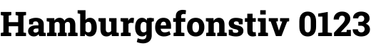 | 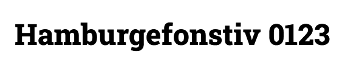 |
| robotoslab-14 | 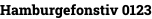 | 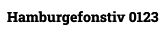 |
| asapsharp-36 | 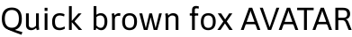 | 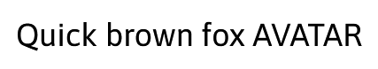 |
| asap-cff-36 | 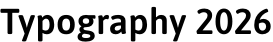 | 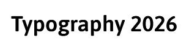 |
| armenian-36 | 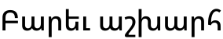 | 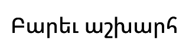 |
| syriac-36 | 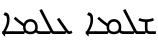 | 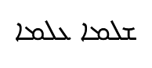 |

## Guarded by tests

`crates/fm-core/src/preview.rs` checks the properties this comparison rests on,
on all three CI platforms: the cap height of a rendered `H` equals the font's
OS/2 cap height within a pixel and the line advances by the font's `hmtx`
widths (`metrics_match_the_font`), kerning and axis values change the output,
and right-to-left and mixed-direction lines are ordered as the OS orders them.
